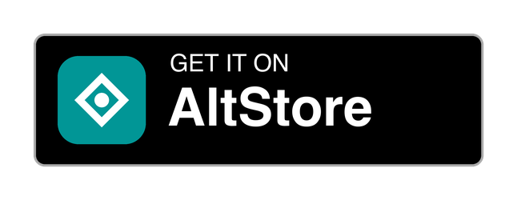
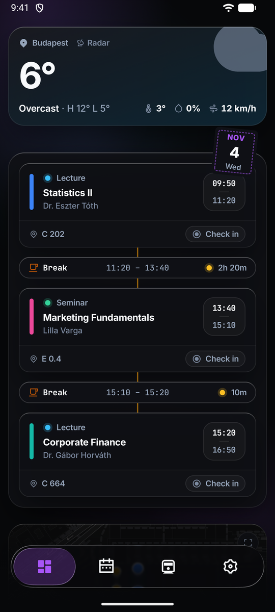
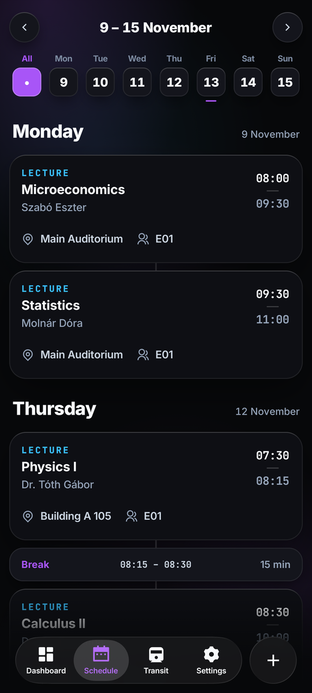
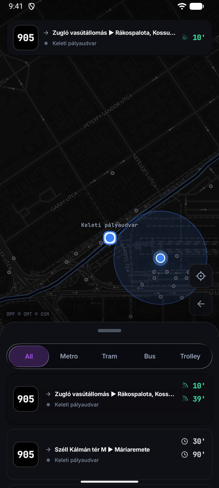
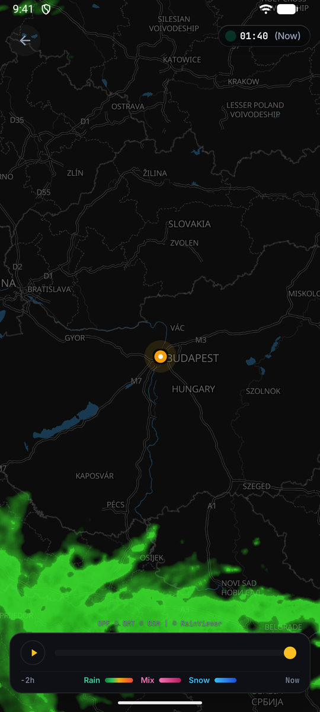
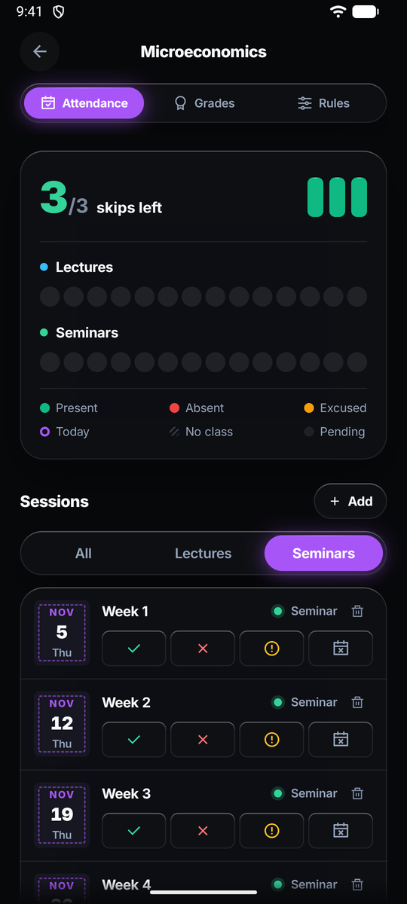
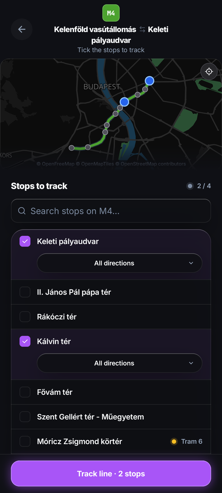
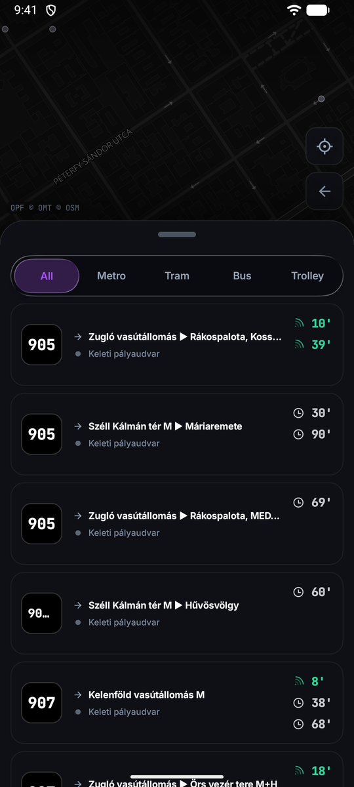
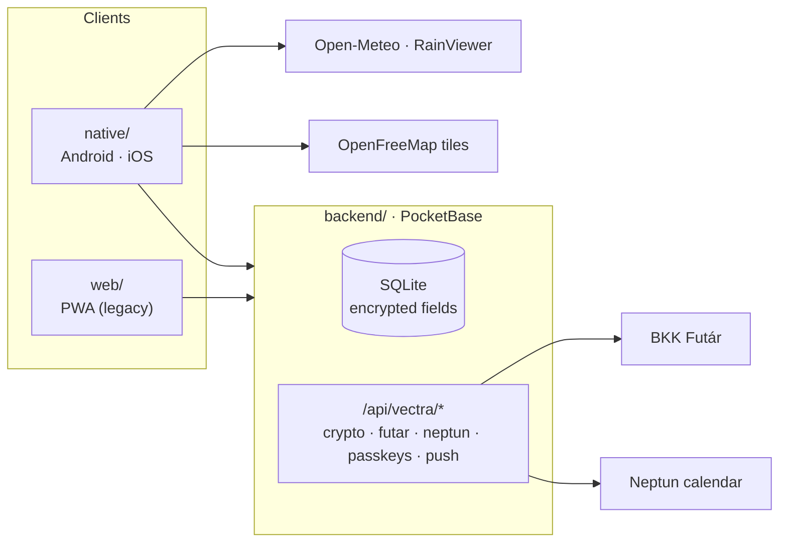

<div align="center">


# Vectra

**Your university timetable, Budapest transit and the weather, in one app.**

Classes from Neptun with your breaks worked out, live departures and vehicles around you, and
attendance you can actually keep track of. Built for students at Corvinus in Budapest.

[](https://github.com/southstar21dev/Vectra/actions/workflows/release.yml)
[](https://github.com/southstar21dev/Vectra/releases/latest)
[](web)


<a href="https://apps.obtainium.imranr.dev/redirect?r=obtainium://add/https://github.com/southstar21dev/Vectra"></a>
<a href="https://github.com/southstar21dev/Vectra/releases/latest"></a>
<a href="https://southstar21dev.github.io/Vectra/"></a>

<br />






</div>

## Why Vectra

A student's day runs on three things: when the next class is, how to get there, and whether to
take an umbrella. They usually live in three apps and a Neptun tab. Vectra puts them on one screen.

- **Your timetable, synced.** Paste your Neptun calendar link once and classes stay up to date,
  with breaks, clashes and exams worked out for you.
- **Transit that's actually live.** Real-time departures from BKK Futár, vehicles moving on the
  map, and the lines you care about pinned.
- **Attendance under control.** Every class gets a hub that counts the skips you have left.
- **Private by default.** Course names, rooms and instructors are encrypted on the server with a
  key that never leaves it.
- **A native, glassy feel.** One Compose Multiplatform codebase on Android and iOS, with a Liquid
  Glass navbar that refracts what's behind it.

## Features

<table>
<tr>
<td width="50%" valign="top">

### Today at a glance
Current weather, today's classes as a timeline with the breaks in between, and the departures
from the stop nearest you. Check in to a class straight from its card.

</td>
<td width="50%" valign="top">

### Week schedule
Classes from Neptun (calendar link or `.ics` file) plus your own, laid out day by day. Shifts and
tasks sit alongside, and Vectra warns you when they clash with a class you have to attend.
Hungarian public holidays and odd/even weeks are handled.

</td>
</tr>
<tr>
<td align="center"></td>
<td align="center"></td>
</tr>
<tr>
<td width="50%" valign="top">

### Course hub
Each course has its own hub: attendance per lecture and seminar with skips left, grades and
points, and the course's attendance rules.

</td>
<td width="50%" valign="top">

### Track your lines
Pick a line, tick the stops you use, and its next departures follow you on the Transit tab,
with service alerts when something's wrong.

</td>
</tr>
<tr>
<td align="center"></td>
<td align="center"></td>
</tr>
<tr>
<td width="50%" valign="top">

### Nearby explorer
A full-screen map of the stops around you with a departures sheet you can pull up and down.
Filter by metro, tram, bus or trolley, and tap a departure to see its route and where the
vehicle is right now.

</td>
<td width="50%" valign="top">

### Weather and radar
Current conditions and the day's forecast from Open-Meteo, and an animated rain, sleet and snow
radar for the last two hours from RainViewer.

</td>
</tr>
<tr>
<td align="center"></td>
<td align="center"></td>
</tr>
</table>

Sign in with email and password, or with a passkey (fingerprint or face) on Android.

## Install

Vectra is distributed through [GitHub Releases](https://github.com/southstar21dev/Vectra/releases).

### Android

| | |
|---|---|
| **Recommended: [Obtainium](https://github.com/ImranR98/Obtainium)** | Tap the badge above (or add `https://github.com/southstar21dev/Vectra` in Obtainium). It installs Vectra and keeps it updated. Set the APK filter to `arm64`. |
| **Manual** | Download `Vectra-<version>-arm64.apk` (practically every phone in use) or `Vectra-<version>.apk` (universal, for anything else) from the latest release. |

Requires Android 8 or newer.

### iPhone

Vectra installs through [AltStore](https://altstore.io), which signs it with your own Apple ID.
On your iPhone, tap the **Get it on AltStore** badge above (or open
[southstar21dev.github.io/Vectra](https://southstar21dev.github.io/Vectra/)) to add the source. Or, in
AltStore, go to **Browse → Sources → +** and add:

```
https://raw.githubusercontent.com/southstar21dev/Vectra/altstore/stable.json
```

Requires iOS 18.5 or newer. You can also download `Vectra-<version>.ipa` from a release and open it
in AltStore or SideStore.

### Betas

Pre-releases are built from the `dev` (`-dev.N`) and `staging` (`-rc.N`) branches. On Android,
enable *Include prereleases* in Obtainium. On iPhone, add the beta source instead (or tap
[*Add the beta source*](https://southstar21dev.github.io/Vectra/#beta) on the install page):

```
https://raw.githubusercontent.com/southstar21dev/Vectra/altstore/beta.json
```

## How it's built

| Folder | What it is |
|---|---|
| [`native/`](native) | The Android and iOS app: Kotlin Multiplatform with Compose Multiplatform. Every screen and feature lives in `shared/`; `androidApp/` and `iosApp/` are thin shells. |
| [`backend/`](backend) | A single Go binary embedding [PocketBase](https://pocketbase.io), with custom routes for field encryption, the Futár proxy, Neptun, passkeys and push. |
| [`web/`](web) | The original PWA (React, Vite). It's being retired in favour of the native app. |



**Native:** Kotlin 2.4 · Compose Multiplatform 1.12 · Navigation 3 · Metro (DI) · Ktor ·
kotlinx.serialization · DataStore · MapLibre Compose · Liquid Glass via
[Kyant's Backdrop](https://github.com/Kyant0/AndroidLiquidGlass) · Credential Manager passkeys ·
Baseline Profiles.

**Backend:** Go · PocketBase · go-webauthn · Web Push.

## Development

```sh
# Backend: builds and serves on 127.0.0.1:8090
make -C backend run

# Native: Android (open native/ in Android Studio, or)
cd native && ./gradlew :androidApp:installDebug
./gradlew :shared:testAndroidHostTest detekt :androidApp:lint   # tests and static analysis

# Native: iOS. The Xcode project is generated from project.yml
cd native/iosApp && xcodegen && open iosApp.xcodeproj

# Web (legacy)
cd web && npm install && npm run dev
```

See [`native/README.md`](native/README.md) and [`native/docs/CONTRIBUTING.md`](native/docs/CONTRIBUTING.md)
for how the app is put together, and [`web/README.md`](web/README.md) for the PWA and the backend's
environment variables.

### Branches and releases

| Branch | Purpose | Releases |
|---|---|---|
| `dev` | Day-to-day work; feature branches and Dependabot PRs merge here. | `1.4.0-dev.N` |
| `staging` | Release candidates. | `1.4.0-rc.N` |
| `master` | Production; the backend and web deploy from here. | `1.4.0` |

[semantic-release](https://semantic-release.gitbook.io/) runs on every push to these branches once
CI passes, and versions from [Conventional Commits](https://www.conventionalcommits.org/):
`feat:` is a minor release, `fix:` and `perf:` are patches, and `!` or `BREAKING CHANGE:` is a major.
`chore:`, `docs:`, `refactor:`, `test:` and `ci:` release nothing. Each release ships a signed APK, an
unsigned IPA and an updated AltStore source.

## License

Copyright © 2026 southstar21. **All rights reserved.** The source is published for reference; it
isn't licensed for reuse. The released apps may be installed for personal use. See [LICENSE](LICENSE).
Code adapted from other projects keeps its original license, as listed in [NOTICE.md](NOTICE.md).

## Credits

- Transit data from [BKK Futár](https://opendata.bkk.hu).
- Maps © [OpenStreetMap](https://www.openstreetmap.org/copyright) contributors, served by
  [OpenFreeMap](https://openfreemap.org) with [OpenMapTiles](https://openmaptiles.org), rendered by
  [MapLibre](https://maplibre.org).
- Weather from [Open-Meteo](https://open-meteo.com) (CC BY 4.0); radar from [RainViewer](https://www.rainviewer.com).
- Liquid Glass rendering by [Kyant0/AndroidLiquidGlass](https://github.com/Kyant0/AndroidLiquidGlass) (Apache-2.0).
- Icons from [Remix Icon](https://remixicon.com).
- [Get it on Obtainium](https://github.com/ImranR98/Obtainium) and [Get it on GitHub](https://github.com/Kunzisoft/Github-badge) badges by their respective projects.
